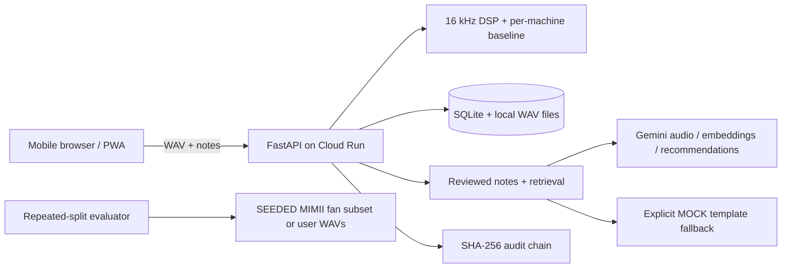

# Machine Passport

A local-first prototype for recording machine sound, building a per-machine baseline, reviewing anomalies, and keeping human decisions and repair outcomes together.

## Run locally

Requires Python 3.11+ and a microphone-enabled browser. In WSL2, open the repository directory and run `make setup && make dev`; otherwise use `python -m pip install -r requirements.txt` and `uvicorn backend.app.main:app --reload --host 0.0.0.0 --port 8000`. Visit `http://localhost:8000`. OpenAPI is at `/docs`. No cloud account or API key is required for the offline template provider.

To use the app on a phone, expose the local server through a trusted HTTPS tunnel and set `PUBLIC_BASE_URL` to its HTTPS URL before starting the server. Browser microphone and motion sensor access generally require HTTPS outside localhost. Scan a machine's QR code to open `/m/{id}`.

## Working prototype flow

Create a machine, record at least eight healthy baseline clips from one placement, build a baseline, record a 5–60 second check, and analyze it. The CPU DSP uses NumPy and SciPy; the scorer uses median/MAD robust normalization and calibrates the threshold from healthy leave-one-out scores at the 95th percentile (minimum 1.0). Scores are blocked until the baseline exists. Non-OK checks can generate a recommendation from stored analysis and technician notes. Approvals, rejections, edits, and outcomes are persisted and added to a SHA-256 audit chain. The app does not take machine action.

Audio clips recorded by the browser and user-entered telemetry are marked REAL. This label means the app recorded or received the value; it does not certify sensor calibration. Simulated telemetry is marked SIMULATED. Voice notes can be recorded or uploaded; Gemini can transcribe, translate and structure them, and Gemini Embedding 2 is used for semantic retrieval when available. Otherwise the app marks the retrieval method `LOCAL_TFIDF`. Gemini-structured notes remain excluded from recommendations until a technician reviews and confirms them. With `GEMINI_API_KEY` or Vertex settings configured, Gemini is the default provider; without credentials, the app labels its deterministic response `MOCK · TEMPLATE, not AI reasoning`. `LLM_PROVIDER` can explicitly select `gemini`, `mock`, or `ollama`. Provider output is checked against retrieved evidence IDs and numeric values; invalid output falls back to the stored-evidence template. Gemini raw output is stored in the local audit database and its SHA-256 is linked into the tamper-evident audit chain. Machine records and audio are stored locally in `data/`.

## Evaluation

Evaluation runs 30 repeated splits by default. The threshold is calibrated from healthy training clips only at the 95th percentile of leave-one-out training scores; faulty clips are test-only. The report includes mean ± standard deviation and bootstrap 95% intervals, and separates public benchmark folders from own recordings. See [docs/CALIBRATION.md](docs/CALIBRATION.md) for the protocol and folder layout. For the included small public fan teaching subset, run `python scripts/download_mimii_fan_subset.py`; those recordings are marked SEEDED and are not a recording of your machine. MIMII fan and pump machine IDs must be downloaded/prepared manually to evaluate more machines. Current results include only data actually present in the local evaluation folders.

To download the small public fan teaching subset for evaluation and demo use, run `python scripts/download_mimii_fan_subset.py`. To run the supplied-data scenario, pass a folder containing `healthy/` and `faulty/` WAV subfolders: `python scripts/seed_demo.py --data /path/to/clips`. It will refuse to run without eight healthy and one faulty clip; all scenario records are marked SEEDED.

For real Gemini verification, configure `GEMINI_API_KEY` (or Vertex AI environment settings), then run `python scripts/verify_gemini.py` and `python -m pytest -m live`. The live fixture audio is synthetic English TTS (not technician recordings). Live calls may incur usage charges. No live Gemini result is claimed unless the verifier reports PASS.

## Limitations

Phone microphones are noisier than contact sensors. A small baseline can be unstable and this prototype only flags a basic dispersion warning. It is not a certified diagnostic tool and must not replace approved maintenance procedures. There is no real authentication or authorization. Browser DeviceMotion capture and Cloud Pub/Sub/GCS adapters are optional and require supported HTTPS devices, Cloud credentials, and configured topics/buckets; they have not been verified against a live sensor or GCP resource. BigQuery and durable offline upload queues are not implemented. The real Gemini verifier requires a configured API key or Vertex project; check its report for the latest run status. The service worker caches the app shell, but uploads require connectivity.

## Related work and how we differ

Industrial condition-monitoring products including Augury, Neuron Soundware, and OxMaint address overlapping maintenance and machine-health workflows. This prototype is an inspectable local demonstration centered on machine-specific phone recordings, a transparent baseline score, linked technician notes, and an explicit human decision trail; it is not a product comparison or a claim of diagnostic parity.

## Deployment

`docker build -t machine-passport .` and `docker run -p 8080:8080 machine-passport` run the local SQLite-backed container. After `gcloud auth login` and project/billing setup, run `./scripts/deploy_cloud_run.ps1 -Project <project-id> -Region asia-south1` from PowerShell. The deploy script configures unauthenticated public ingress for the demo; do not put sensitive data in it. The default container filesystem is ephemeral. To persist uploaded audio and a consistent SQLite snapshot, provide a private GCS bucket with object create/read/delete access to the Cloud Run service identity: `./scripts/deploy_cloud_run.ps1 -Project <project-id> -StorageBucket <bucket>`. For audit event publication, create a Pub/Sub topic, grant publisher access, and pass `-AuditTopic <topic>`. To ingest telemetry, publish JSON shaped as `{"schema":"machine_passport.telemetry.v1","machine_id":1,"rows":[{"metric":"rpm","value":1450,"unit":"rpm","provenance":"REAL"}]}` and run `python scripts/consume_pubsub_telemetry.py --project <project-id> --subscription <subscription>`. Pub/Sub and GCS need Application Default Credentials / the Cloud Run service identity. Firestore is used only for a shared Gemini daily quota. See [docs/DEMO_SCRIPT.md](docs/DEMO_SCRIPT.md), [docs/PILOT_SHEET.md](docs/PILOT_SHEET.md), and [docs/CALIBRATION.md](docs/CALIBRATION.md).

## Layout

`backend/app` contains API and signal processing; `frontend` contains the mobile-first PWA shell; `eval` contains the clip-level evaluation harness; `docs/ASSUMPTIONS.md` records implementation choices.

## Architecture

## Claims to evidence

| Claim | Evidence | Boundary |
|---|---|---|
| WAV upload validates rate, duration and quality and normalizes supported rates for analysis | `backend/tests/test_dsp.py`; `backend/app/main.py` | Phone-specific behavior still needs real device recordings |
| Gain-scaled copies have similar feature scores | `backend/tests/test_dsp.py` | Synthetic/scaled WAV test, not a multi-phone field study |
| Baseline threshold uses healthy training data only | `backend/tests/test_eval_protocol.py`; `docs/CALIBRATION.md` | Split-level repeat uncertainty is not new-site uncertainty |
| Current benchmark result | `eval/results/latest.md` | One small SEEDED public fan subset; no pump or own-machine recordings |
| Recommendation evidence IDs are checked; empty retrieval fails closed | `backend/tests/test_providers.py`; `backend/tests/test_memory_integrity.py` | Mock tests do not prove real Gemini behavior |
| Audio notes require human confirmation; raw provider output is auditable | `backend/tests/test_memory_integrity.py`; `backend/app/main.py` | Real Gemini path requires configured credentials; see live verifier |
| Demo machine is seeded idempotently and sample clips follow analysis routes | `backend/tests/test_api.py`; `scripts/smoke_test.py` | Public deployment must pass smoke checks after deployment |
| Audit changes are detectable | `backend/tests/test_memory_integrity.py` | Local chain integrity does not prove an external trusted timestamp |
| Feedback is real and counts are data-derived | `backend/tests/test_memory_integrity.py`; `/api/metrics/latest` | No user feedback is claimed until submitted |
| Public service has health, request limits, upload limits and cleanup | `scripts/deploy_cloud_run.ps1`; `scripts/smoke_test.py`; `backend/app/main.py` | Cloud IAM, Firestore quota access and current revision require deployed verification |
| Browser motion data can be captured and stored as REAL telemetry | `frontend/app.js` (`captureAccelerometer`); `POST /api/telemetry` | Requires an HTTPS phone browser exposing DeviceMotion and explicit sensor permission; no real device run is claimed |
| GCS audio objects and SQLite snapshots can be used when configured | `backend/app/storage.py`; `backend/tests/test_adapters.py` | Adapter round-trip tested against a local fake client; live bucket and IAM not verified |
| Audit events can publish to Pub/Sub; a pull worker ingests versioned telemetry messages | `backend/app/eventbus.py`; `scripts/consume_pubsub_telemetry.py`; `backend/tests/test_adapters.py` | No live topic/subscription or IAM was available |
| Ollama recommendations use JSON schema and the same server grounding validator | `backend/app/providers.py`; `backend/tests/test_providers.py` | Request/response was tested with a mocked Ollama API; no live Ollama server was available |

This is a local-first screening demonstration, not a certified diagnostic system or a performance comparison with Augury, Neuron Soundware, OxMaint, or Manusis. Related products address overlapping workflows; no parity or novelty claim is made.
